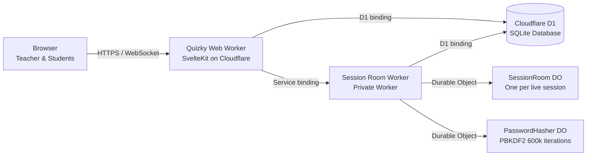

# Quizky

**Play. Think. Win.**

Quizky is a live, teacher-led multiplayer quiz platform built for Cloudflare's free tier. Teachers register, author multiple-choice quizzes, and launch live sessions with a short human-friendly join code. Students join in real time using only the join code and a nickname—no student account required—and answer questions under server-enforced deadlines while the hosting teacher controls progression and views the live leaderboard and post-game breakdown.

This repository is the complete MVP implementation of [`quizky-agent-spec.md`](./quizky-agent-spec.md).

## Status

| Milestone                                | State |
| ---------------------------------------- | ----- |
| 0 — Repository and deployment foundation | Done  |
| 1 — Database and teacher authentication  | Done  |
| 2 — Quiz authoring                       | Done  |
| 3 — Session creation and lobby           | Done  |
| 4 — Game engine                          | Done  |
| 5 — Results and recovery                 | Done  |
| 6 — Hardening and deployment             | Done  |

## Features

- **Teacher Authentication & Ownership:** Email/password registration and login with PBKDF2-HMAC-SHA-256 (`600,000` iterations, random 16-byte salt, 256-bit key) executed inside a dedicated `PasswordHasher` Durable Object, paired with `HttpOnly`, `SameSite=Lax` cookie sessions and strict per-teacher ownership checks.
- **MCQ Quiz Authoring:** Create, edit, reorder, publish, archive, and delete multiple-choice quizzes (`1–50` questions per quiz, `2–6` options per question, `5–120s` timers, `1–1000` points). Publishing enforces full structural validation.
- **Immutable Session Snapshots:** Launching a live session snapshots all questions and options into D1 and initializes a dedicated `SessionRoom` Durable Object so edits to a quiz never corrupt an active or historical game.
- **Frictionless Student Join & Reconnect:** Collision-resistant 6-character join codes (`ABCDEFGHJKLMNPQRSTUVWXYZ23456789`), shareable join links, nickname normalization and per-session uniqueness, and `HttpOnly` + `sessionStorage` participant tokens (`SHA-256` hashed at rest) for seamless refresh/reconnect recovery without duplicate participants.
- **Server-Authoritative Real-Time Game Engine:** Explicit state machine (`lobby` → `in_progress` [`pending` / `open` / `closed`] → `completed` / `aborted`) backed by Durable Object SQLite storage and `alarm()` timers for automatic question timeout progression, manual teacher advance, idempotent one-answer-per-question enforcement, and deterministic tie-breaking.
- **Teacher-Only Leaderboard & Persistent Results:** Answer keys and leaderboards are strictly stripped from student WebSocket and HTTP payloads. Completed sessions sync back to Cloudflare D1 so detailed per-question and per-student results remain reviewable even after Durable Object eviction or Worker redeployment.
- **Abuse Protection:** Same-origin CSRF enforcement on all state-changing routes, strict Zod validation with 64 KB JSON body caps, HTTP sliding-window rate limiting on auth and join routes, and per-socket WebSocket message rate limiting (`rate_limited`).

## Architecture



- **Web worker (`quizky`)** — Public SvelteKit entrypoint handling SSR pages, REST API routes, authentication cookies, quiz CRUD, session creation, and authenticated WebSocket upgrade forwarding.
- **Session Room worker (`quizky-session-room`)** — Private Worker reached exclusively via the `SESSION_ROOMS` service binding (`workers_dev: false`). Exports two SQLite-backed Durable Object classes:
  - `SessionRoom`: One instance per `sessionId`, coordinating WebSockets, `alarm()` deadlines, idempotent answer recording (`room_answers`), and `/rooms/:sessionId/export` state synchronization.
  - `PasswordHasher`: Runs 600,000-iteration PBKDF2-HMAC-SHA-256 (~270 ms CPU time in `workerd`) within the Durable Object 30-second CPU budget rather than the 10 ms Free Worker HTTP CPU limit.
- **Cloudflare D1 (`DB`)** — Permanent relational store for teachers, sessions, quizzes, immutable session snapshots, participants, participant answers, and post-game results.

### Why a second Worker for Durable Objects?

`@sveltejs/adapter-cloudflare` generates the web worker entrypoint and does not expose custom named Durable Object class exports from the same bundle. Cloudflare requires Durable Object classes to be named exports of a Worker entrypoint. Hosting `SessionRoom` and `PasswordHasher` in `workers/session-room` behind a private service binding keeps all public HTTP/SSR routing inside SvelteKit while giving Durable Objects a clean, isolated TypeScript build.

In local development, `vite dev` (`http://localhost:5173`) and `wrangler dev` (`http://127.0.0.1:8788`) run side by side via `pnpm run dev:all`.

## Tech stack

- SvelteKit 3 + Svelte 5 (runes mode), TypeScript (strict mode)
- Cloudflare Workers, Durable Objects (SQLite-backed), Cloudflare D1
- Drizzle ORM + Drizzle Kit SQL migrations
- Zod schema validation
- Vitest (unit, integration, and end-to-end tests)
- pnpm

## Prerequisites

- Node.js **22.17 or newer** (required by SvelteKit 3)
- pnpm 10+ (`corepack enable pnpm`)
- A Cloudflare account for deployment (Workers Free plan; no payment card required for D1, Workers, or SQLite-backed Durable Objects)

## Local setup

```sh
corepack enable pnpm
pnpm install
pnpm run gen
pnpm run db:migrate:local
```

`pnpm run gen` generates Cloudflare binding types from `wrangler.jsonc` and `workers/session-room/wrangler.jsonc`. Re-run `pnpm run gen` whenever bindings change.

## Run the app

Start both the SvelteKit web server and the local Durable Object worker:

```sh
pnpm run dev:all
```

- Web app: `http://localhost:5173`
- Session Room worker (internal dev endpoint): `http://127.0.0.1:8788`

Or run them in separate terminals:

```sh
pnpm run dev        # SvelteKit web app
pnpm run dev:room   # Session Room & PasswordHasher Durable Object worker
```

## Cloudflare bindings & migrations

### D1 (`DB`)

Both `wrangler.jsonc` and `workers/session-room/wrangler.jsonc` declare a D1 binding named `DB` pointing to `quizky-db`. The checked-in `database_id` (`00000000-0000-0000-0000-000000000000`) works out of the box for local development.

For production deployment, create the D1 database once and update `database_id` in both `wrangler.jsonc` and `workers/session-room/wrangler.jsonc`:

```sh
pnpm run db:create
```

Apply SQL migrations locally or remotely:

```sh
pnpm run db:migrate:local
pnpm run db:migrate:remote
```

Generate a new migration after editing `src/lib/server/db/schema.ts`:

```sh
pnpm exec drizzle-kit generate
```

### Durable Objects (`SESSION_ROOM` and `PASSWORD_HASHER`)

`workers/session-room/wrangler.jsonc` declares:

- `SessionRoom` and `PasswordHasher` in `new_sqlite_classes` migration `v1` (SQLite storage is mandatory on the Cloudflare Free plan),
- `SESSION_ROOM` and `PASSWORD_HASHER` Durable Object bindings,
- `workers_dev: false` so the room worker has no public URL.

The web worker (`wrangler.jsonc`) binds to `quizky-session-room` via the `SESSION_ROOMS` service binding. Always deploy the room worker first (`pnpm run deploy` handles ordering automatically).

## Environment variables and secrets

Cloudflare bindings are configured in `wrangler.jsonc`.

- `.env.example` documents optional local development URL overrides (` QUIZKY_DEV_ROOM_ORIGIN`).
- Use `.dev.vars` (gitignored) for local Wrangler secrets if needed.
- Use `pnpm exec wrangler secret put <SECRET_NAME>` for production secrets.
- Never commit real credentials, tokens, or `.dev.vars` files.

## Commands

| Command                      | Purpose                                                   |
| ---------------------------- | --------------------------------------------------------- |
| `pnpm run dev`               | Start the SvelteKit development server                    |
| `pnpm run dev:room`          | Start the Session Room Durable Object worker locally      |
| `pnpm run dev:all`           | Start both local servers concurrently                     |
| `pnpm run build`             | Regenerate Cloudflare types and build production bundle   |
| `pnpm run preview`           | Preview the built web worker locally                      |
| `pnpm run check`             | Run `svelte-check` and room worker `tsc --noEmit`         |
| `pnpm run check:room`        | Type-check `workers/session-room`                         |
| `pnpm run lint`              | Check formatting with Prettier and lint with ESLint       |
| `pnpm run format`            | Format all files with Prettier                            |
| `pnpm test`                  | Run all unit, integration, and E2E tests once with Vitest |
| `pnpm run test:unit`         | Run Vitest in watch mode                                  |
| `pnpm run gen`               | Regenerate Cloudflare Worker binding types                |
| `pnpm run db:create`         | Create the production D1 database                         |
| `pnpm run db:migrate:local`  | Apply D1 migrations to local SQLite state                 |
| `pnpm run db:migrate:remote` | Apply D1 migrations to remote Cloudflare D1               |
| `pnpm run deploy:room`       | Deploy `quizky-session-room` worker                       |
| `pnpm run deploy:web`        | Build and deploy the `quizky` SvelteKit worker            |
| `pnpm run deploy`            | Deploy `quizky-session-room` followed by `quizky`         |

## Deployment, rollback, and recovery

### Deploying to Cloudflare

1. Authenticate Wrangler: `pnpm exec wrangler login`
2. Create the D1 database (`pnpm run db:create`) and copy the `database_id` into `wrangler.jsonc` and `workers/session-room/wrangler.jsonc`.
3. Apply remote D1 migrations: `pnpm run db:migrate:remote`
4. Run quality gates: `pnpm run format && pnpm run lint && pnpm run check && pnpm test && pnpm run build`
5. Deploy both workers in order: `pnpm run deploy`

### Rollback and recovery

- **Worker code rollback:** Run `pnpm exec wrangler rollback` (for the web worker) or `pnpm --dir workers/session-room exec wrangler rollback` to immediately revert to the previous Worker deployment version.
- **Database backup / export:** Before applying new remote migrations, export D1 data or schema with:
  ```sh
  pnpm exec wrangler d1 export quizky-db --remote --output=quizky-backup.sql
  ```
- **Durable Object hibernation & restart recovery:** `SessionRoom` persists every state transition, participant, answer, and idempotency key in its SQLite tables (`room_state`, `room_questions`, `room_participants`, `room_answers`, `room_processed_requests`). If an object hibernates or restarts, `reconcileDeadlines()` compares `Date.now()` against `question_deadline_at` and automatically transitions expired questions. Completed sessions are also synchronized to D1 (`game_sessions`, `participants`, `participant_answers`) via `/rooms/:sessionId/export`.
- **Teacher disconnect behavior:** Disconnecting or closing the teacher's browser tab does **not** destroy or abort an active session. If a question is open, the Durable Object `alarm()` still closes the question on schedule (or completes the session if it was the final question). When the teacher reconnects, they receive a full `room_snapshot` and resume control (`teacher_advance_question` / `teacher_end_game`). If a teacher never reconnects on a non-final closed question, the room remains safely in `question_closed` until the teacher returns to advance or end the session.

### Production smoke-test checklist

- [ ] `https://<web-worker>/` renders over HTTPS with zero console errors.
- [ ] Teacher registration, login, and logout work; session cookies are `HttpOnly` and `Secure`.
- [ ] A teacher can create, edit, reorder, and publish an MCQ quiz.
- [ ] Launching a session produces a 6-character join code and shareable link.
- [ ] Two students join from separate browser contexts and appear live in the lobby.
- [ ] Starting the game delivers Question 1 with a synchronized countdown timer.
- [ ] Each student can submit only one answer per question; duplicate or late answers are rejected.
- [ ] Question timers automatically close/advance via Durable Object `alarm()` even if no teacher clicks advance.
- [ ] Refreshing a student browser mid-question reconnects to the same participant identity without resetting the timer.
- [ ] Only the owning teacher can access `/api/sessions/:sessionId/leaderboard`, `/api/sessions/:sessionId/results`, and `/sessions/:sessionId/results`.
- [ ] Completed session results remain accessible in `/sessions/:sessionId/results` after a Worker redeploy.

## Known limitations and free-tier constraints

Quizky is designed to run on Cloudflare's **Free plan** without a payment card. Re-verify official Cloudflare quotas before production launch, as provider limits can change:

| Service                           | Free-Tier Quota                                                                                                              | Behavior When Quota Is Exceeded                                                                                                 | Quizky Mitigation                                                                                                                                 |
| --------------------------------- | ---------------------------------------------------------------------------------------------------------------------------- | ------------------------------------------------------------------------------------------------------------------------------- | ------------------------------------------------------------------------------------------------------------------------------------------------- |
| **Cloudflare Workers**            | 100,000 HTTP requests/day (UTC); **10 ms CPU time** per HTTP invocation                                                      | Cloudflare returns HTTP `1015` / `503` until the daily UTC reset or throws `Error: Worker exceeded CPU time limit`.             | Zero background HTTP polling; live gameplay uses a single upgraded WebSocket per participant; PBKDF2 hashing is offloaded to `PasswordHasher` DO. |
| **Durable Objects (Free SQLite)** | 100,000 requests/day; **30,000 ms (30 s) CPU time** per invocation; 5 GB total SQLite storage; max 50 Durable Object classes | New DO requests/WebSocket upgrades fail with `503` / quota errors until daily reset; writes fail if 5 GB SQLite cap is reached. | Uses `new_sqlite_classes` (`SessionRoom`, `PasswordHasher`), WebSocket hibernation (`this.ctx.acceptWebSocket`), and per-socket rate limiting.    |
| **Cloudflare D1**                 | 5,000,000 rows read/day; 100,000 rows written/day; 5 GB total storage                                                        | D1 queries throw quota errors (`500 internal_error` via `apiErrorResponse`) until UTC midnight.                                 | Live gameplay reads/writes occur inside `SessionRoom` SQLite storage rather than querying D1 on every student answer; D1 is synced in batches.    |
| **WebSockets**                    | Idle connections may be closed by intermediate networks or runtime eviction                                                  | Socket `close` event fires in the browser.                                                                                      | Client automatically reconnects with exponential backoff (`1s–8s`) and resyncs via `room_snapshot` + `reconcileDeadlines()`.                      |

## Troubleshooting

**Generated binding types look stale**

Run `pnpm run gen` to regenerate `worker-configuration.d.ts` and `workers/session-room/worker-configuration.d.ts`.

**`vite dev` starts but D1 queries fail with `no such table`**

Apply local migrations with `pnpm run db:migrate:local`.

**Login, registration, or live session creation returns `503` in local development**

Ensure the Session Room Durable Object worker is running (`pnpm run dev:room` or `pnpm run dev:all`). The web worker calls `http://127.0.0.1:8788` in local dev for `PasswordHasher` and `SessionRoom`.

**`wrangler deploy` rejects the D1 `database_id`**

Replace the placeholder `00000000-0000-0000-0000-000000000000` in `wrangler.jsonc` and `workers/session-room/wrangler.jsonc` with the UUID printed by `pnpm run db:create`.
